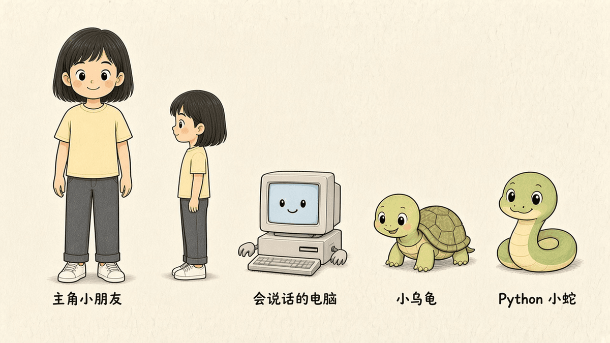

# 小学生学编程（Python · 漫画）

书名工作名：**小学生学编程（Python · 漫画）**

## 这本书怎么读（双线）

- **低年级**：每章看漫画开场 → 照着打代码 → 完成小项目即可。
- **高年级**：在上面基础上加读「概念 / 流程图」说明，并做章末挑战题。

同一套目录、两种阅读深度；后面也可拆成上下册。

## 工程路径

```
/workspace/books/kids-python/
  README.md              # 本说明
  STYLE.md               # 声口、禁区、双线标注
  TOC.md                 # 定稿 16 章目录
  TEMPLATE-chapter.md    # 章模板（六段）
  chapters/              # 分章书稿 md
  code/                  # 每章可跑 Python 案例
  experiments/           # 实验清单与实测记录
  art-briefs/            # 每章插图的画面说明（brief）
  art/                   # 全书漫画插图与角色设定图
```

设计源：`/workspace/plans/kids-python-book/2026-11-02-设计要点.md`  
实施计划：`/workspace/docs/superpowers/plans/2026-11-02-kids-python-comic-book.md`

## 与 Type Ninja 的衔接

打字基本功可用 Type Ninja（编程预备课）练；本书侧重「看懂流程图 → 照打 Python → 做出小项目」。收束章会写衔接与家长陪练小贴士。

## 插图说明

全书漫画插图（80 张分镜加一张角色设定图 `art/characters.png`）已经放在 `art/` 下，并按画面嵌进了各章书稿；清单见 `art/README.md`。



## 完成度

全书 16 章已经全部成稿，每章都有六段结构。下表的测试状态来自 `experiments/batch-smoke.md` 的批测记录（2026-11-03，Python 3.13.5）。

| 章 | 项目 | 脚本 | 测试状态 |
| --- | --- | --- | --- |
| 1 · 计算机在干什么，为什么选 Python | 我的三个指令 | 无（纸笔活动） | 不需要跑代码 |
| 2 · 程序概念与流程图 | 起床上学流程图 → 伪代码 | 无（流程图与伪代码） | 不需要跑代码 |
| 3 · 装环境与第一行代码 | Hello 世界变装 | `code/ch03/hello_dressup.py` | 已实测通过 |
| 4 · 变量与输入输出 | 自我介绍生成器 | `code/ch04/intro_generator.py` | 已实测通过 |
| 5 · 运算与字符串 | 小卖部计算器 | `code/ch05/shop_calculator.py` | 已实测通过 |
| 6 · 条件判断 | 猜拳裁判 | `code/ch06/rps_judge.py` | 已实测通过（三种结果都测了） |
| 7 · 循环 | 倒计时火箭 | `code/ch07/rocket_countdown.py` | 已实测通过 |
| 8 · 列表 | 班级点名册 | `code/ch08/roll_call.py` | 已实测通过 |
| 9 · 函数 | 心情天气播报 | `code/ch09/mood_weather.py` | 已实测通过 |
| 10 · 字典 | 宠物档案卡 | `code/ch10/pet_card.py` | 已实测通过 |
| 11 · 文件读写 | 日记本 | `code/ch11/diary.py` | 已实测通过（含追加写入） |
| 12 · 报错与调试 | 修 bug 闯关 | `code/ch12/buggy.py`、`code/ch12/fixed.py` | 已实测通过（buggy.py 按预期报错） |
| 13 · 简单图形 turtle | 迷宫 | `code/ch13/maze.py` | 未测，只编译通过，需要在有窗口的电脑上运行 |
| 14 · 小游戏综合 | 猜数字加强版 | `code/ch14/guess_number.py` | 已实测通过（固定种子 42） |
| 15 · 数据小实验 | 班级身高统计图 | `code/ch15/height_chart.py` | 已实测通过 |
| 16 · 综合大项目与继续学 | 简易商店 | `code/ch16/mini_shop.py` | 已实测通过 |

GitHub 仓库：https://github.com/reesun/kids-python
