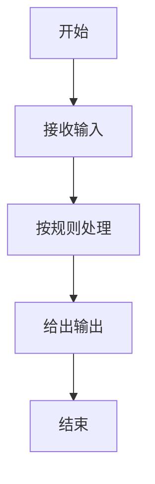

# 第 1 章 · 计算机在干什么，为什么选 Python

电脑不会自己想主意，它只会按你给的一步步指令做事。这一章先搞清楚「指令」是什么，以及为什么我们用 Python 来写这些指令。读完你就能跟别人讲清楚：编程到底在干什么。

## 漫画开场
（插图位：主角小朋友对着会说话的电脑，电脑头顶冒出一串方块指令；见 `art-briefs/ch01.md` 画面 1–2）

主角小朋友问：「电脑这么聪明，是不是什么都会？」
电脑摇头：「我只是跑得很快。你不说清楚，我一步都不会动。」

## 概念

计算机做三件简单的事：

1. **接收输入**：键盘、鼠标、触摸屏告诉它你想干什么。
2. **按规则处理**：把输入变成中间结果（算一算、比一比、记一记）。
3. **给出输出**：屏幕上显示字、图，或者喇叭出声。

**程序**就是一串写清楚的指令。你写好顺序，电脑就按顺序执行——不会跳步，也不会「猜你的意思」。

为什么选 **Python**？

- 句子读起来接近日常说话，适合刚开始学的你。
- 同一套写法从「打印你好」能一路做到小游戏和简单数据分析。
- 学校和青少年编程考级里也很常见（我们只参考考纲，不硬背等级）。

<!-- high -->
程序和「应用软件」的关系：微信、浏览器也是别人写好的程序。学 Python，就是学自己当那个「写指令的人」。
<!-- /high -->

## 流程图或伪代码

先用流程图记住「电脑干活」的大顺序（本章还不写真代码）：



伪代码（人话版）：

```
收到你的话
按规则想一想
把结果告诉你
```

## 照着打

本章还没装编程软件，先**在纸上或备注里**照着抄这三行人话指令，感受「一步一步」：

```
1. 问出名字
2. 拼出一句问候
3. 打印到屏幕
```

第 3 章装好环境后，你会把这三步变成真正的 Python。想提前偷看真代码，可以翻到 `code/ch03/hello_dressup.py`，但请先完成本章小项目。

## 小项目：我的三个指令

目标：找生活里「按步骤做事」的例子，练的是**拆步骤**，不是敲代码。

1. 写出一件你每天会做的事（例如泡方便面、收拾书包）。
2. 把它拆成 **3～5 个有序步骤**（每步一句话）。
3. 标出哪一步是「输入」、哪一步是「输出」（可以没有也没关系）。

完整代码：本章无 `.py` 文件（真代码从第 3 章开始）。  
实验清单：可用纸笔完成；若家长陪练，把步骤拍照存档即可。

## 高年级挑战题
<!-- high -->
1. 如果某一步说得含糊（例如「弄好一点」），电脑会怎样？试着把含糊步骤改成「可执行」的说法。
2. 同一个「输出」，换一种输入，结果会变吗？举一个生活例子说明「输入不同 → 输出不同」。
3. 查一查：Python 以外还有哪些常见编程语言？选一个，用一句话说明它常出现在什么地方（不要求会写）。
