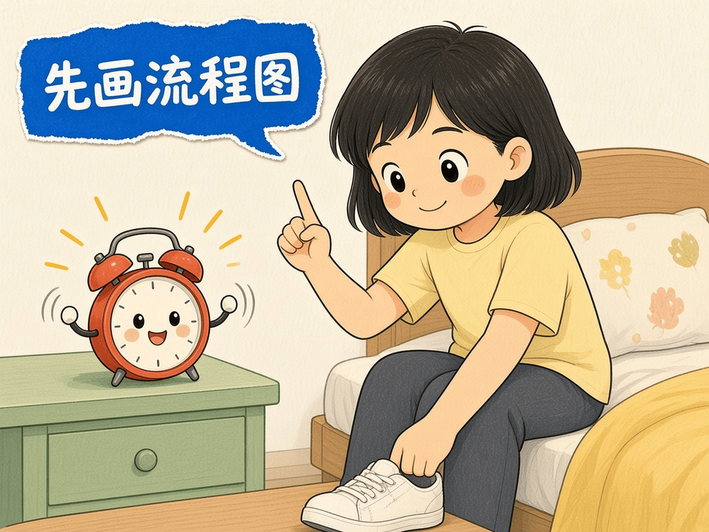
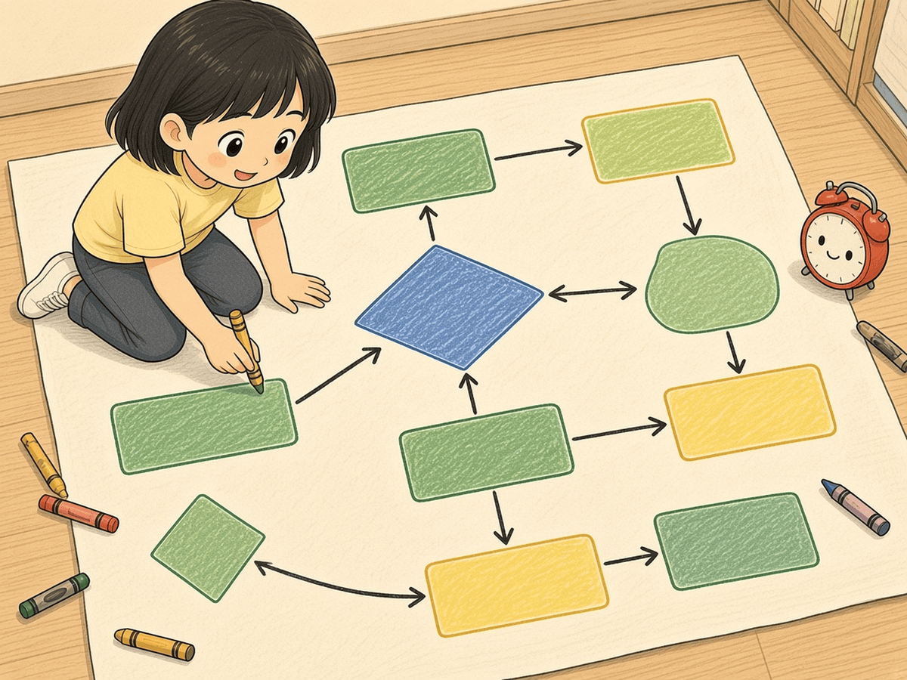
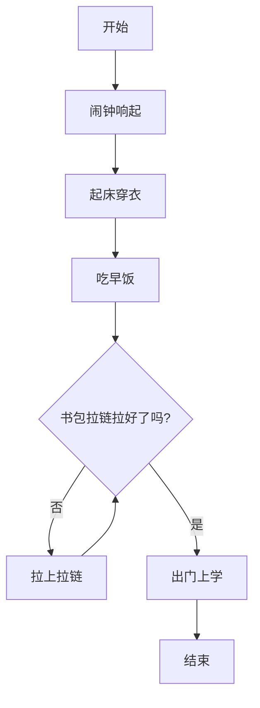
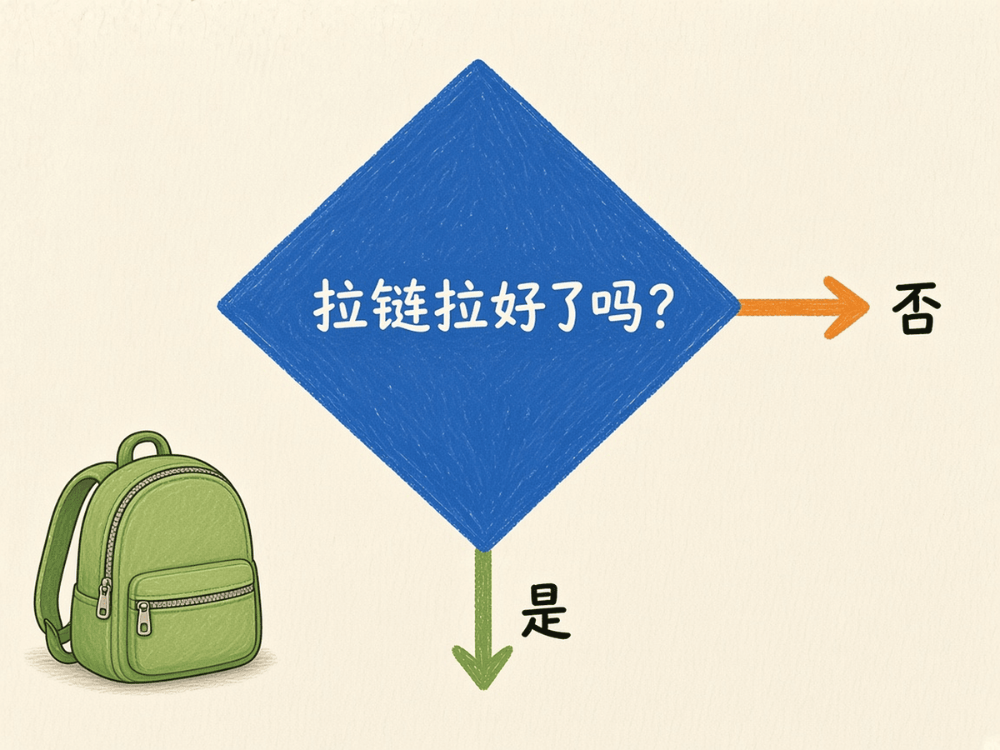
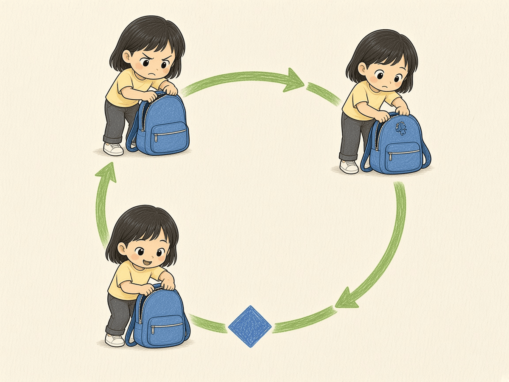
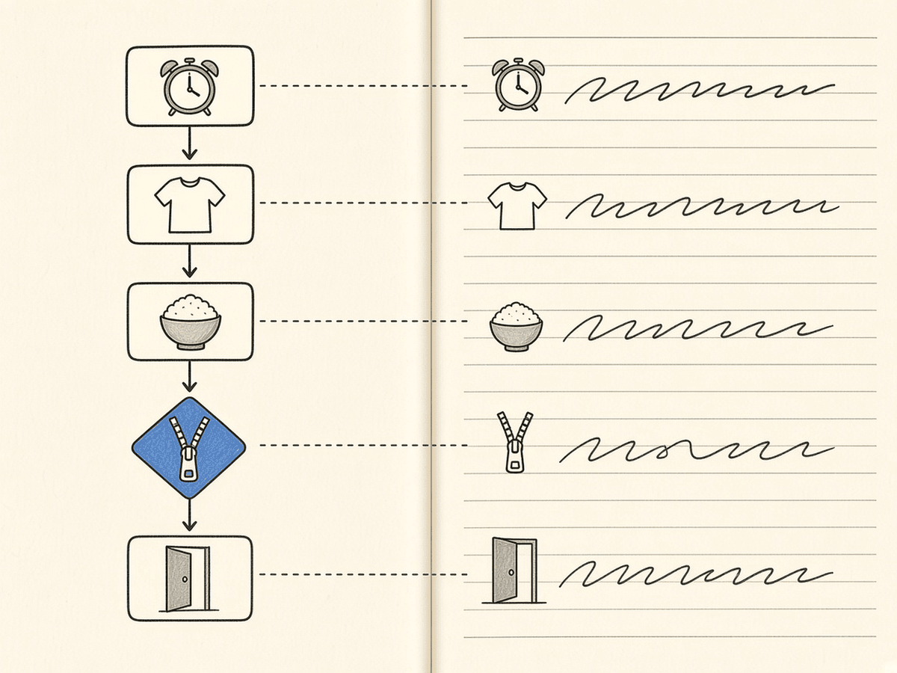

# 第 2 章 · 程序概念与流程图

写代码之前，先学会「画清楚再动手」。流程图用方框和箭头告诉你：先做什么、遇到问题怎么分岔、哪一段要重复。这一章你要把「起床上学」画成图，再翻成伪代码。

## 漫画开场





闹钟：「叮铃铃——」
主角：「别急着穿鞋！先画流程图，搞清楚顺序。」

## 概念

程序里最常见的三种结构：

1. **顺序**：一步接一步，像排队。
2. **判断（分支）**：问一个是/否的问题，走不同的路。
3. **循环**：某一段重复做，直到条件满足才停。

流程图常用符号（本书用 mermaid 画，漫画版见本章插图）：

- 圆角框：开始 / 结束
- 方框：要做的事
- 菱形：判断（是 / 否）
- 箭头：下一步往哪走

伪代码是「给人看的草稿指令」，还不是 Python，但顺序已经和真程序很像。

## 流程图或伪代码

下面这张图同时用了**顺序、判断、循环**（出门前检查书包拉链：没拉好就再拉一次）：



说明：

- `闹钟 → 起床 → 早饭 → …` 是**顺序**
- `拉链拉好了吗？` 菱形是**判断**
- `否 → 拉上拉链 → 再问一次` 是**循环**（直到拉好）





## 照着打

请把上面的流程**照着抄成伪代码**（可以写在本子上，也可以打成文本文件）。注意缩进只是为了好看，本章还不要求 Python 语法。

```
开始
闹钟响起
起床穿衣
吃早饭
当 书包拉链没有拉好 时：
    拉上拉链
出门上学
结束
```



## 小项目：起床上学流程图 → 伪代码

目标：自己画一版「起床上学」，再翻成伪代码。

1. 在纸上或用 mermaid 画流程图，**必须**包含：至少 3 步顺序、1 个判断、1 处循环。
2. 把图翻成伪代码（人话指令，自上而下）。
3. 给家人讲一遍：哪一步是判断？哪一段在循环？


完整代码：本章无 Python 文件（先想再敲）。  
实验清单：见 `experiments/ch02.md`。

## 高年级挑战题
<!-- high -->
1. 给流程图再加一个判断：「下雨了吗？」——下雨就带伞，不下雨就直接出门。画出新菱形和两条分支。
2. 循环如果永远停不下来会怎样？给「拉链」循环加一个上限：最多拉 3 次，仍不行就喊家长帮忙。
3. 把伪代码里的「当…时」改成「重复 N 次」写法，对比两种循环说法有什么不同。
