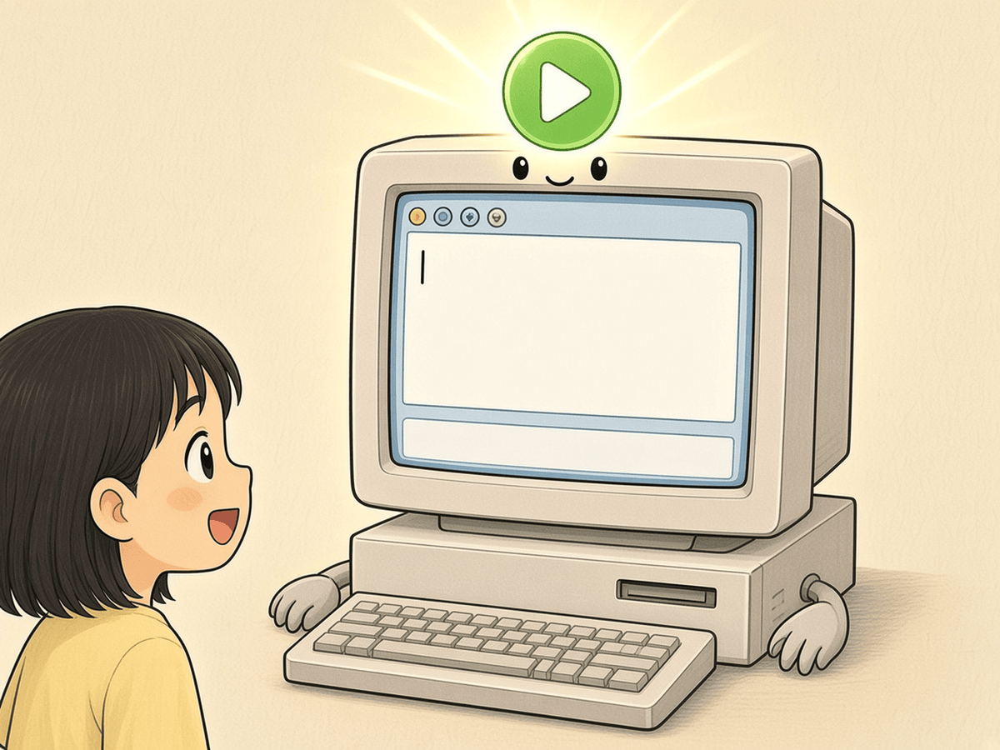
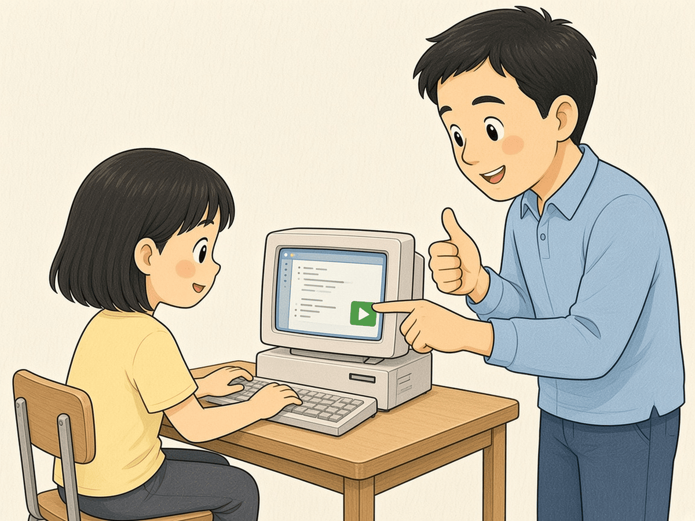
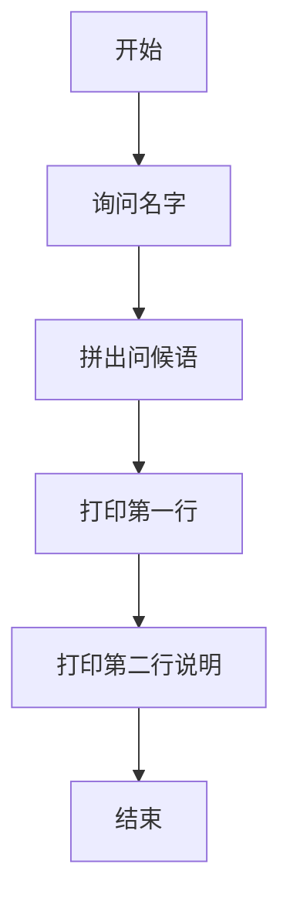
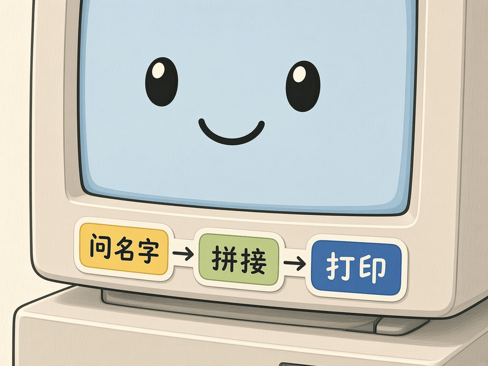
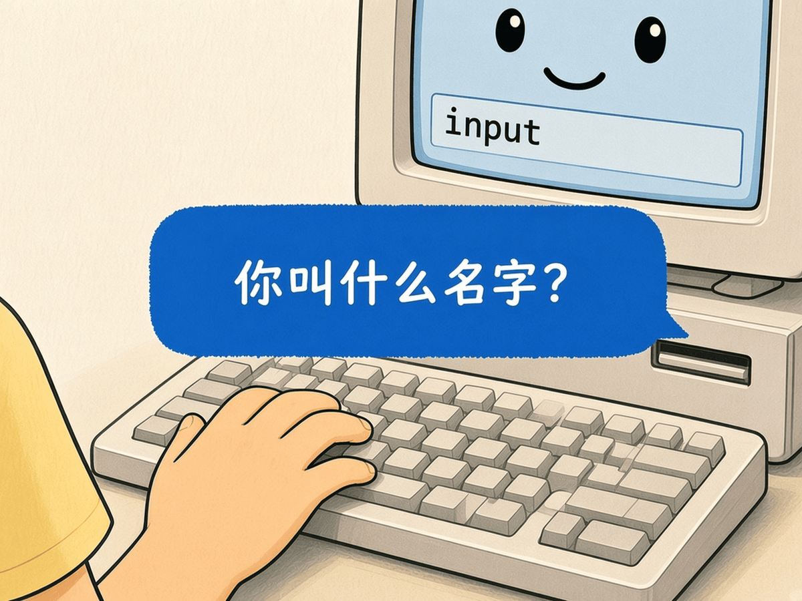
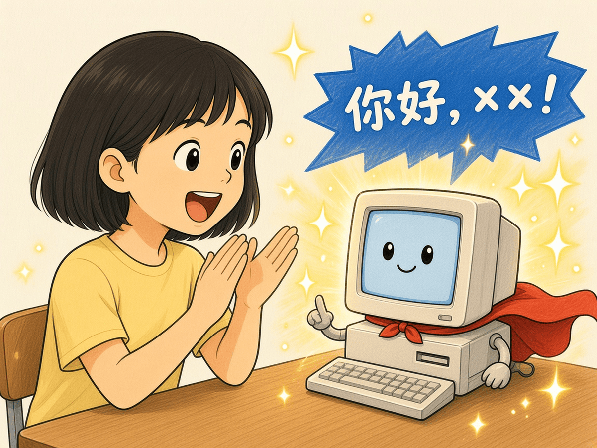

# 第 3 章 · 装环境与第一行代码

这一章你要让电脑听懂 Python：装好编辑器，打出第一段会问名字的问候程序。做完小项目「Hello 世界变装」，你就正式开始「照着打 → 看见结果」的循环了。

## 漫画开场



电脑：「准备好了。把指令打给我吧。」
主角：「先问名字，再变装问候！」

## 概念

- **解释器**：负责读你的 Python 句子并立刻执行。
- **编辑器**：你打字的地方。本书示例按 **Thonny**（免费、界面简单）来写，其他编辑器也可以，步骤略有不同。
- **运行**：点绿色三角或按快捷键，程序从上到下执行。
- **`input`**：向你提问，把你打的字存进变量。
- **`print`**：把结果打印到屏幕。

装环境时请家长一起：从官网下载适合你家电脑系统的 Thonny，安装后打开，能看到上方写代码、下方看结果的窗口即可。



## 流程图或伪代码





伪代码：

```
问：你叫什么名字？
把回答存进 name
打印「你好，」+ name +「！」
打印「今天我们用 Python 跟电脑说话。」
```

## 照着打

打开 Thonny（或你的编辑器），**新建文件**，照着打下面几行，保存为 `hello_dressup.py`，再运行。

```python
# 你好世界变装：先问名字，再打招呼
name = input("你叫什么名字？ ")
print("你好，" + name + "！")
print("今天我们用 Python 跟电脑说话。")
```

提示：`input` 后面括号里的字会出现在屏幕上；你打完名字按回车，后面的 `print` 才会继续。



## 小项目：Hello 世界变装

目标：运行问候程序，输入自己的名字，屏幕出现两行带名字的问候。



完整代码：见 `code/ch03/hello_dressup.py`  
实验清单：见 `experiments/ch03.md`

家长可在终端替你测一遍（把 `小明` 换成你的名字）：

```bash
printf '小明\n' | python3 code/ch03/hello_dressup.py
```

## 高年级挑战题
<!-- high -->
1. 再问一个问题（例如「今天心情怎么样？」），把答案拼进第三行 `print`。
2. 如果直接运行、却什么都不输入就关闭窗口，会发生什么？试着解释给低年级同学听。
3. 把两行 `print` 合并成一行，中间用空格或 `\n` 换行，对比两种写法的屏幕效果。
