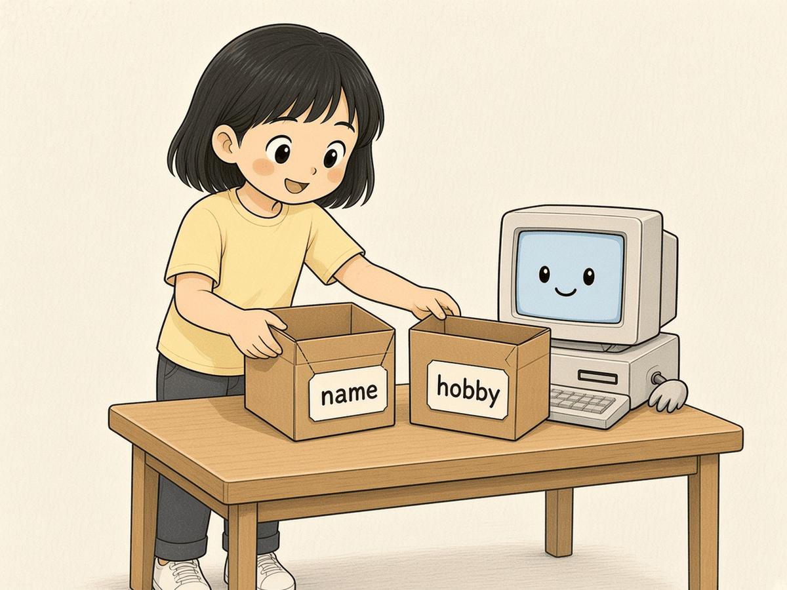
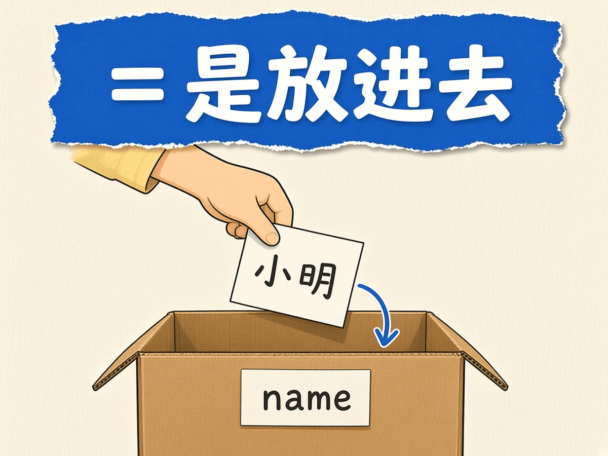
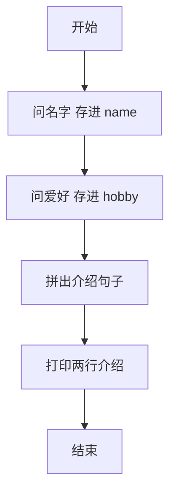
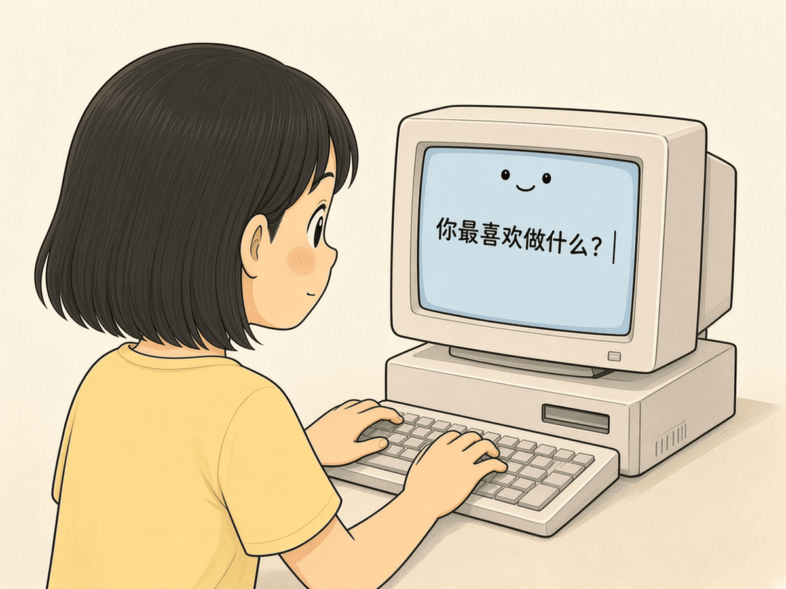
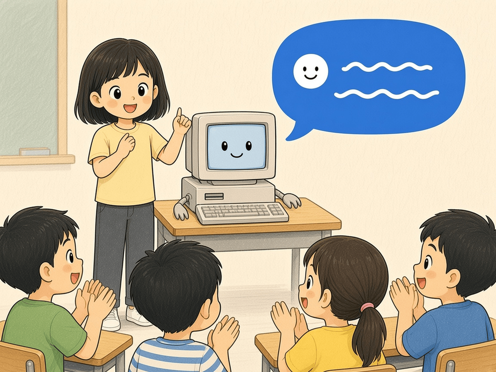

# 第 4 章 · 变量与输入输出

变量就像贴了名字的小盒子，可以把东西放进去、以后再拿出来。这一章你会用 `input` 往盒子里装答案，用 `print` 把盒子里的东西说出来。做完你就有一个会帮你自我介绍的小程序。

## 漫画开场



主角：「电脑，你记得住我的名字吗？」
电脑：「给我一个贴好标签的盒子，我就记得住。」

## 概念

- **变量**：有名字的盒子。`name = "小明"` 意思是：把「小明」放进叫 `name` 的盒子。
- **`=` 不是等于**，是「放进去」。
- **输入**：`input("问题")` 把你打的字交给程序，通常马上放进变量。
- **输出**：`print(...)` 把内容显示在屏幕上。
- **字符串**：用引号包起来的文字，可以用 `+` 拼在一起。



<!-- high -->
变量名规则：只能用字母、数字、下划线，不能以数字开头，大小写不同（`Name` 和 `name` 是两个盒子）。起名要看得懂，如 `hobby` 比 `h` 好。
<!-- /high -->

## 流程图或伪代码



## 照着打

照着打下面几行，运行后回答两个问题：

```python
# 自我介绍生成器
name = input("你叫什么名字？ ")
hobby = input("你最喜欢做什么？ ")
print("大家好，我叫" + name + "。")
print("我最喜欢" + hobby + "，很高兴认识你们！")
```



## 小项目：自我介绍生成器

目标：程序先问姓名和爱好，再打印一段自我介绍。
完整代码：见 `code/ch04/intro_generator.py`
实验清单：见 `experiments/ch04.md`



## 高年级挑战题
<!-- high -->
1. 再加一个变量 `age`，问「你几岁？」，把年龄放进介绍里。
2. 如果什么都不输入直接回车，介绍会变成什么样？怎样给它加一个默认值（提示：第 6 章的判断会帮你）。
3. 把同一个变量 `name` 用两次：开头打招呼、结尾再说「再见，××」。
