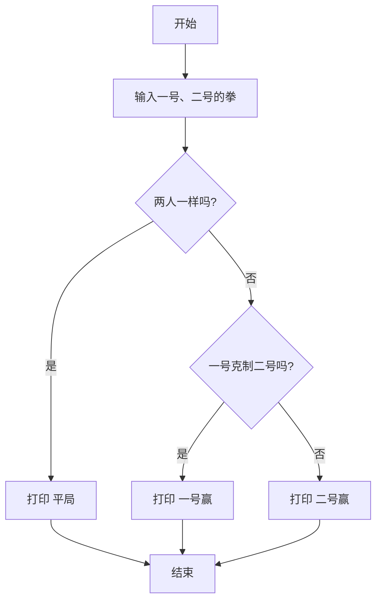

# 第 6 章 · 条件判断

程序也会「看情况办事」：如果这样，就那样；否则，换一种做法。这一章学 `if`、`elif`、`else`，做一个公平的猜拳裁判。

## 漫画开场
（插图位：两个小朋友猜拳，电脑戴着裁判帽举牌；见 `art-briefs/ch06.md` 画面 1–2）

小红：「石头！」 小刚：「剪刀！」
电脑裁判：「让我判断一下……」

## 概念

- **比较**：`==` 等于、`!=` 不等于、`>`、`<`、`>=`、`<=`，结果是 `True`（真）或 `False`（假）。
- `if 条件:` 条件为真才做下面缩进的事。
- `elif 另一个条件:` 前面不成立时再试这一个。
- `else:` 以上都不成立就做这里。
- **缩进**（4 个空格）表示「这几行属于这个如果」。
- `and` 两个都对才对；`or` 有一个对就对。

## 流程图或伪代码



「克制」规则：石头赢剪刀、剪刀赢布、布赢石头。

## 照着打

照着打，冒号和缩进一个都不能少：

```python
# 猜拳裁判
player_one = input("一号出什么（石头/剪刀/布）？ ")
player_two = input("二号出什么（石头/剪刀/布）？ ")
if player_one == player_two:
    print("平局！")
elif (player_one == "石头" and player_two == "剪刀") or \
     (player_one == "剪刀" and player_two == "布") or \
     (player_one == "布" and player_two == "石头"):
    print("一号赢！")
else:
    print("二号赢！")
```

行尾的 `\` 表示「这句话还没完，接下一行」。

## 小项目：猜拳裁判

目标：输入两拳，打印胜负。
完整代码：见 `code/ch06/rps_judge.py`
实验清单：见 `experiments/ch06.md`

## 高年级挑战题
<!-- high -->
1. 边界情况：有人输入了「拳头」。加一个判断，不是石头/剪刀/布就打印「出拳无效」。
2. 嵌套判断：先判断一号出的是什么，再在里面判断二号，改写成 `if` 套 `if` 的版本，比较哪种更好读。
3. 回到第 5 章：买满 10 元打九折，用 `if` 写出来。
