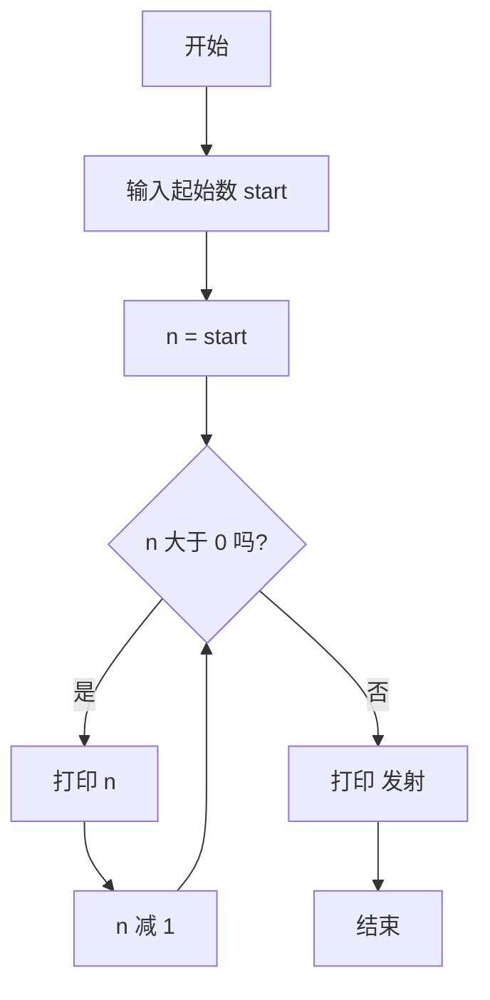

# 第 7 章 · 循环

重复的事交给电脑，它一点也不嫌烦。这一章学 `for` 和 `range`，让程序从 10 数到 1，然后——发射火箭！

## 漫画开场
（插图位：发射台上的小火箭，主角小朋友举着倒数牌；见 `art-briefs/ch07.md` 画面 1–2）

指挥中心：「准备倒计时！」
主角：「要我写十行 print？不，一个循环就够了！」

## 概念

- **循环**：让一段代码重复执行。
- `for n in range(开始, 停止, 步长):` 让 `n` 依次取一串数字。
- `range(5, 0, -1)` 得到 5、4、3、2、1（**不含**停止的 0）。
- 循环体要缩进；循环结束后，没缩进的那行才执行。
- 循环计数变量可以用短名字 `n` 或 `i`（STYLE 允许的例外）。

<!-- high -->
另一种循环 `while 条件:` 会一直重复直到条件为假，第 14 章猜数字会用到。小心条件永远为真的「停不下来」——这就是第 2 章拉链循环的上限问题。
<!-- /high -->

## 流程图或伪代码



## 照着打

照着打，看看 `range` 里三个数字分别管什么：

```python
# 倒计时火箭
start = int(input("从几开始倒数？ "))
for n in range(start, 0, -1):
    print(n)
print("发射！🚀")
```

## 小项目：倒计时火箭

目标：从 N 倒数到 1，再打印发射。
完整代码：见 `code/ch07/rocket_countdown.py`
实验清单：见 `experiments/ch07.md`

## 高年级挑战题
<!-- high -->
1. 边界情况：输入 `0` 或负数会怎样？加判断，打印「请输入大于 0 的数」。
2. 嵌套循环：用两层 `for` 打印一个 3 行、每行 5 颗星 `*` 的长方形。
3. 改成每次少 2：从 10 倒数为 10、8、6、4、2，再发射。
