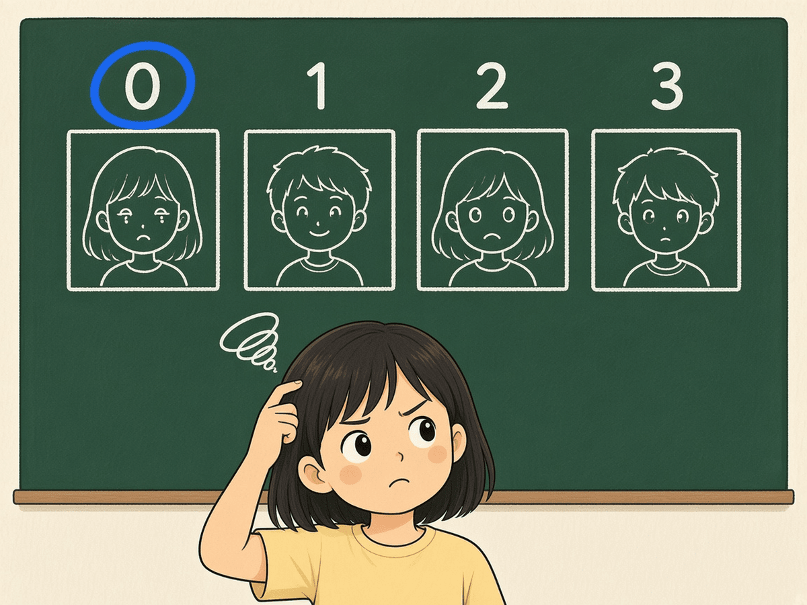
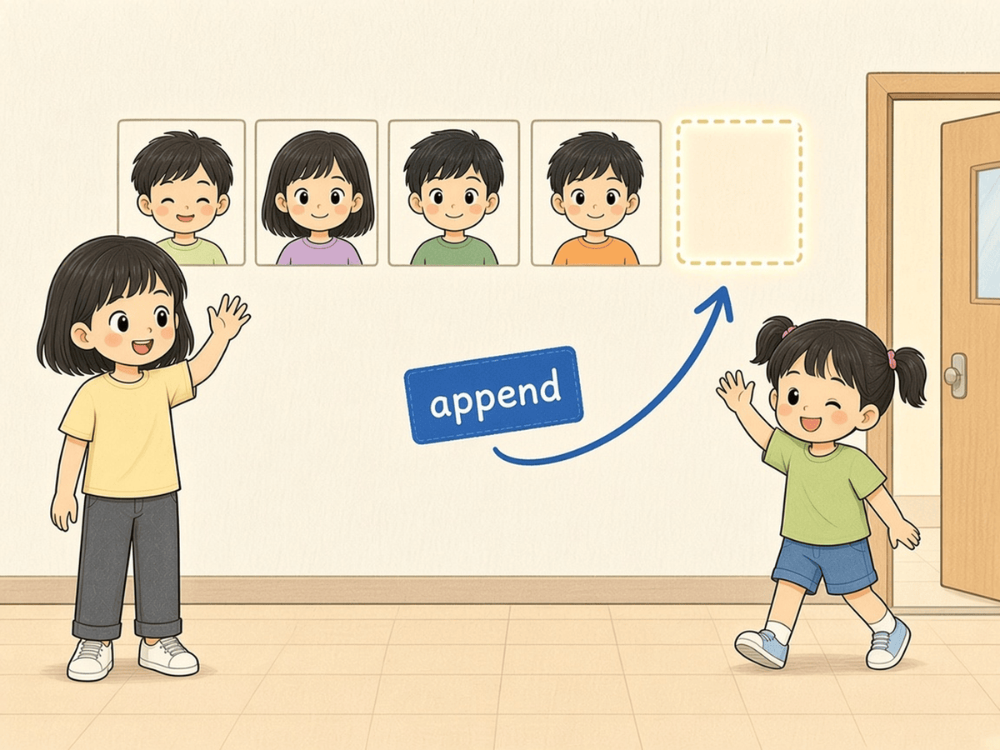
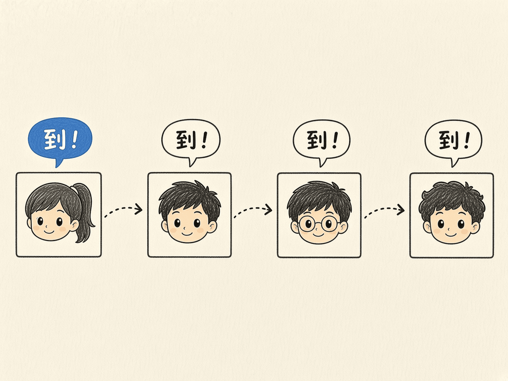
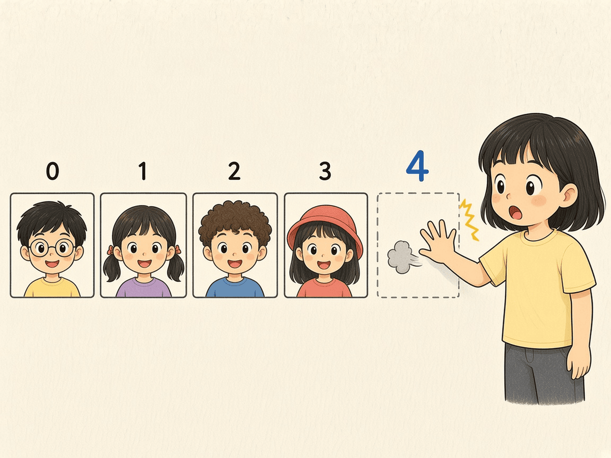

# 第 8 章 · 列表

一个变量只能装一样东西，那全班同学的名字怎么办？列表就是一排连在一起的格子。这一章把名字放进列表，再用循环一个个点名。

## 漫画开场


老师：「开始点名！」
电脑：「名单交给我，我保证一个都不漏。」

## 概念

- **列表**：用方括号 `[]` 装很多东西，逗号隔开：`students = ["小明", "小红"]`。
- **下标**：格子编号从 **0** 开始，`students[0]` 是第一个人。
- `len(列表)` 数一数有几个。
- `for student in students:` 依次取出每一个。
- 增加：`students.append("小李")`；删除：`students.remove("小红")`。





## 流程图或伪代码

```
准备名单列表 students
打印 共有几人
对 名单里的每一个 student：
    打印 student + "：到！"
打印 点名结束
```

## 照着打

照着打，然后把名单换成你们班同桌的名字：

```python
# 班级点名册
students = ["小明", "小红", "小刚", "小美"]
print("开始点名，共 " + str(len(students)) + " 人")
for student in students:
    print(student + "：到！")
print("点名结束！")
```

## 小项目：班级点名册

目标：列表存名字，循环打印「到！」。
完整代码：见 `code/ch08/roll_call.py`
实验清单：见 `experiments/ch08.md`



## 高年级挑战题
<!-- high -->



1. 边界情况：`students[4]` 会怎样？列表只有 4 人时，最后一个下标是几？
2. 用 `append` 让用户输入一个新同学名字加进列表，再点一次名。
3. 嵌套：再建一个 `absent = ["小刚"]`，点名时在循环里用 `if student in absent:` 打印「请假」，否则打印「到！」。
