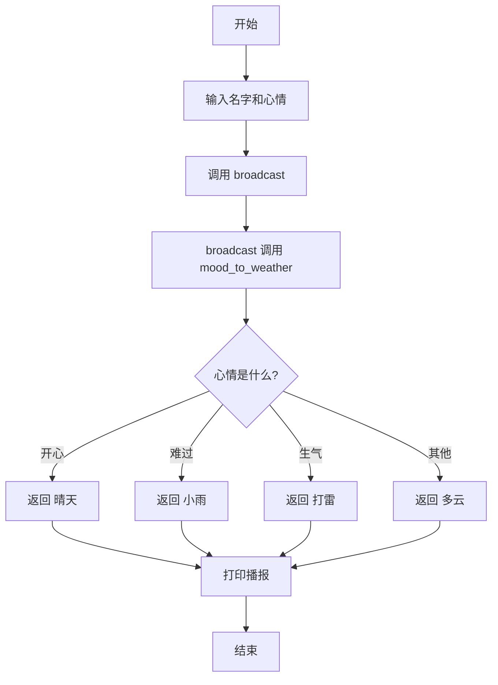

# 第 9 章 · 函数

有些步骤会反复用到，每次都重写一遍太累了。函数就是给一串步骤起个名字，想用时喊一声名字就行。这一章你会自己造两个函数，做一个心情天气播报员。

## 漫画开场
（插图位：主角小朋友当电视天气主播，背后屏幕显示「心情→天气」转换机；见 `art-briefs/ch09.md` 画面 1–2）

主播主角：「各位观众，今天的心情天气是——」
电脑：「把心情交给我的函数，天气马上出来！」

## 概念

- **函数**：一个有名字的步骤包。你已经用过别人写好的函数：`print`、`input`、`len`。
- **定义**：`def 函数名(参数):`，下面缩进写步骤。
- **参数**：调用时塞进去的材料，比如 `mood`。
- **返回值**：`return` 把结果交回给喊它的人。
- **调用**：`mood_to_weather("开心")`——只定义不调用，函数不会动。
- 一个函数里可以调用另一个函数（本书主册不做「自己调用自己」）。

## 流程图或伪代码



## 照着打

照着打，注意 `def` 那行末尾的冒号和函数体的缩进：

```python
# 心情天气播报
def mood_to_weather(mood):
    if mood == "开心":
        return "晴天 ☀️"
    elif mood == "难过":
        return "小雨 🌧️"
    elif mood == "生气":
        return "打雷 ⛈️"
    else:
        return "多云 ☁️"


def broadcast(name, mood):
    weather = mood_to_weather(mood)
    print("📺 心情天气播报：" + name + " 今天是 " + weather)


name = input("你叫什么名字？ ")
mood = input("今天心情怎么样（开心/难过/生气/其他）？ ")
broadcast(name, mood)
```

## 小项目：心情天气播报

目标：自定义函数把心情变成天气，再由播报函数说出来。
完整代码：见 `code/ch09/mood_weather.py`
实验清单：见 `experiments/ch09.md`

## 高年级挑战题
<!-- high -->
1. 再加一种心情「紧张」→「刮风 🌬️」，只改一个函数就够了吗？
2. 写一个新函数 `broadcast_family(names, mood)`，参数是名字列表，用循环给全家各播报一次（函数里调用函数 + 循环）。
3. 边界情况：如果把 `return` 写成 `print`，`weather` 变量里会是什么？运行看看并解释。
