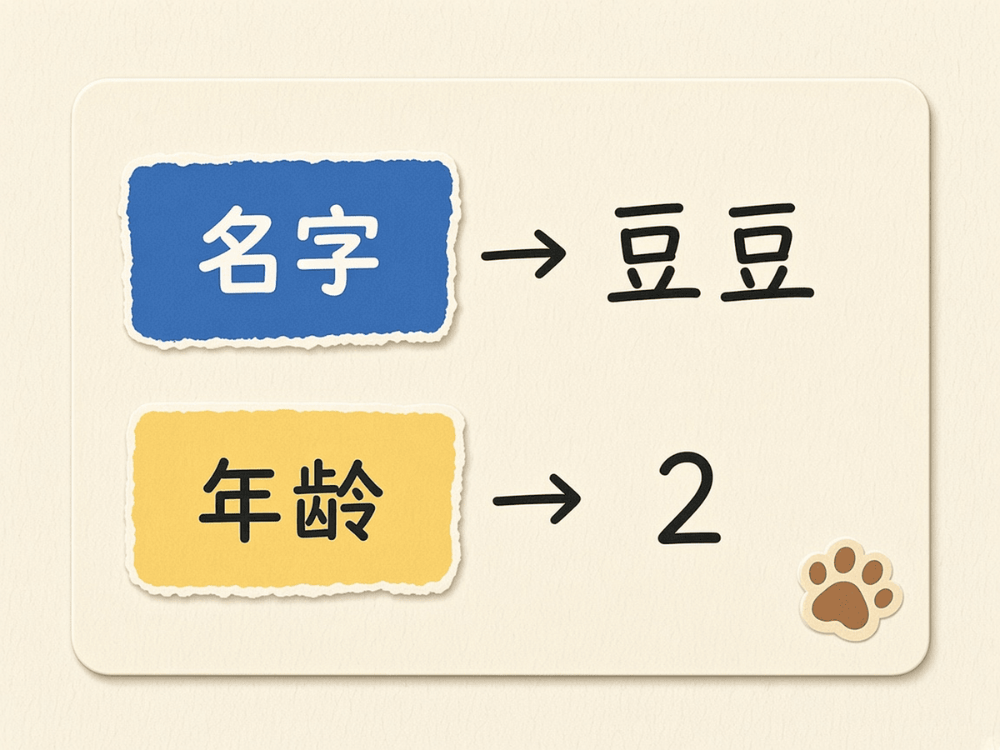
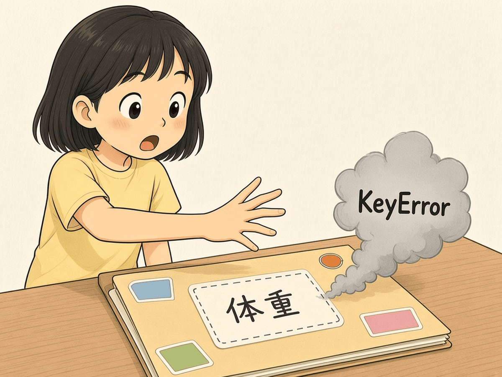
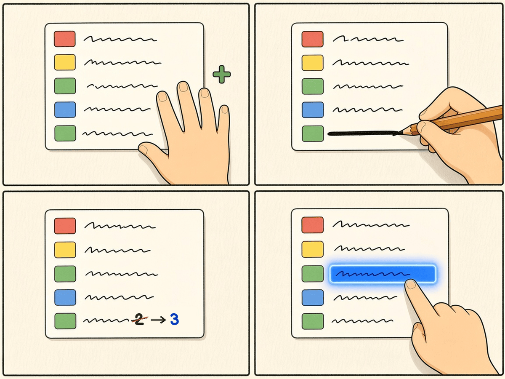
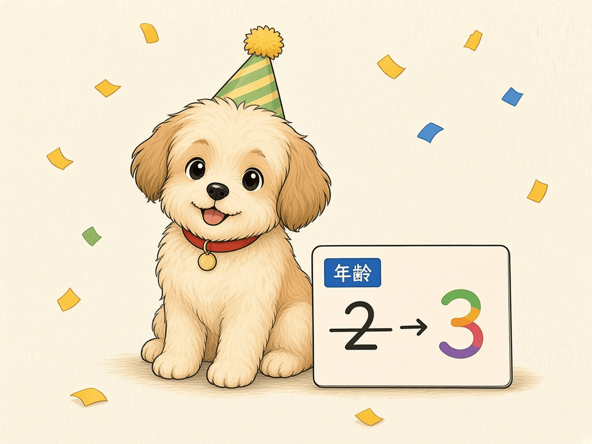

# 第 10 章 · 字典

列表按编号找东西，可「第 2 格是年龄」很难记。字典让你用名字找东西：说「年龄」，就拿到年龄。这一章给宠物建一张档案卡，练习增、删、改、查。

## 漫画开场


主角：「豆豆几岁？爱吃什么？我全记在卡上！」
豆豆：「汪！（别忘了写我爱吃骨头）」

## 概念

- **字典**：用花括号 `{}` 装「键: 值」配对，例如 `{"名字": "豆豆"}`。
- **键**像标签，**值**是标签后面的内容。
- **查**：`pet["名字"]`
- **增**：`pet["爱吃"] = "骨头"`（新标签就是新增）
- **改**：`pet["年龄"] = 3`（旧标签就是修改）
- **删**：`del pet["种类"]`
- `for key in pet:` 依次取出每个键。



<!-- high -->
查一个不存在的键会报 `KeyError`。更稳的写法是 `pet.get("体重", "未知")`，找不到就给默认值。



<!-- /high -->

## 流程图或伪代码

```
建档案 pet：名字=豆豆，种类=小狗，年龄=2
查：打印 名字
增：问 爱吃什么，存进 pet["爱吃"]
改：年龄 加 1，打印 新年龄
删：去掉 种类
对 pet 里每个键：打印 键：值
```



## 照着打

照着打，每段注释对应一种操作：

```python
# 宠物档案卡
pet = {"名字": "豆豆", "种类": "小狗", "年龄": 2}

# 查
print("名字：" + pet["名字"])

# 增
pet["爱吃"] = input("豆豆爱吃什么？ ")

# 改
pet["年龄"] = pet["年龄"] + 1
print("过生日啦，现在 " + str(pet["年龄"]) + " 岁")

# 删
del pet["种类"]

print("=== 宠物档案卡 ===")
for key in pet:
    print(key + "：" + str(pet[key]))
```



## 小项目：宠物档案卡

目标：字典的增、删、改、查各出现一次，最后打印整张卡。
完整代码：见 `code/ch10/pet_card.py`
实验清单：见 `experiments/ch10.md`

## 高年级挑战题
<!-- high -->
1. 边界情况：删掉 `种类` 之后再 `print(pet["种类"])`，会报什么错？用 `get` 改成不报错。
2. 嵌套：建一个列表 `pets`，里面放两张字典档案卡，用循环把两只宠物的名字都打印出来。
3. 写一个函数 `show_card(pet)`（第 9 章），把打印档案卡的代码装进去。
