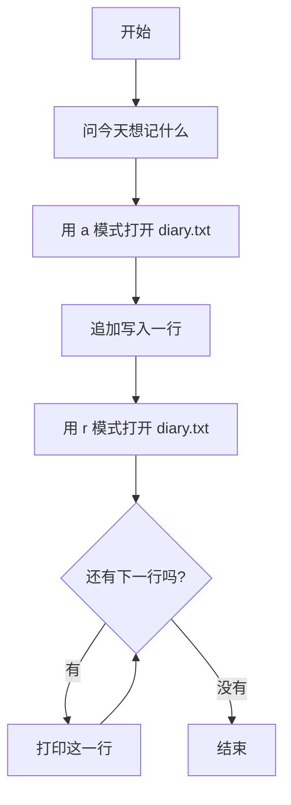

# 第 11 章 · 文件读写

程序一关，变量里的东西就全忘了。把内容写进文件，下次打开还在。这一章做一本日记本：每次运行追加一行，再把整本读出来。

## 漫画开场
（插图位：主角小朋友把一页纸塞进电脑侧面的抽屉，抽屉上写着 diary.txt；见 `art-briefs/ch11.md` 画面 1–2）

主角：「昨天写的日记，今天还能看到吗？」
电脑：「放进文件抽屉里，关机也不会丢。」

## 概念

- **文件**：保存在电脑硬盘上的内容，程序关了也还在。
- `open(路径, 模式, encoding="utf-8")` 打开文件；中文一定要写 `encoding="utf-8"`。
- 模式：`"r"` 读，`"w"` 写（会**清空**原内容！），`"a"` 追加（接在后面写）。
- `with open(...) as diary_file:` 用完自动关上文件。
- `write(文字 + "\n")` 写一行；`for line in diary_file:` 一行行读。
- `line.strip()` 去掉行尾的换行符。

## 流程图或伪代码



## 照着打

照着打，`diary.txt` 会自动出现在脚本旁边：

```python
# 日记本
from pathlib import Path

diary_path = Path(__file__).parent / "diary.txt"

entry = input("今天想记什么？ ")
with open(diary_path, "a", encoding="utf-8") as diary_file:
    diary_file.write(entry + "\n")

print("=== 我的日记 ===")
with open(diary_path, "r", encoding="utf-8") as diary_file:
    for line in diary_file:
        print("· " + line.strip())
```

第一行 `from pathlib import Path` 是让程序找到「自己所在的文件夹」，这样不管从哪里运行，日记都写在同一个地方。

## 小项目：日记本

目标：读写同一个 `diary.txt`，运行两次，确认两行日记都在。
完整代码：见 `code/ch11/diary.py`
实验清单：见 `experiments/ch11.md`

## 高年级挑战题
<!-- high -->
1. 把 `"a"` 改成 `"w"` 再运行两次，日记还剩几行？说说为什么。
2. 边界情况：第一次运行前 `diary.txt` 还不存在，为什么用 `"a"` 不会报错，而先用 `"r"` 读就会报错？
3. 让日记带日期：用 `from datetime import date`，写入时在开头加上 `str(date.today())`。
