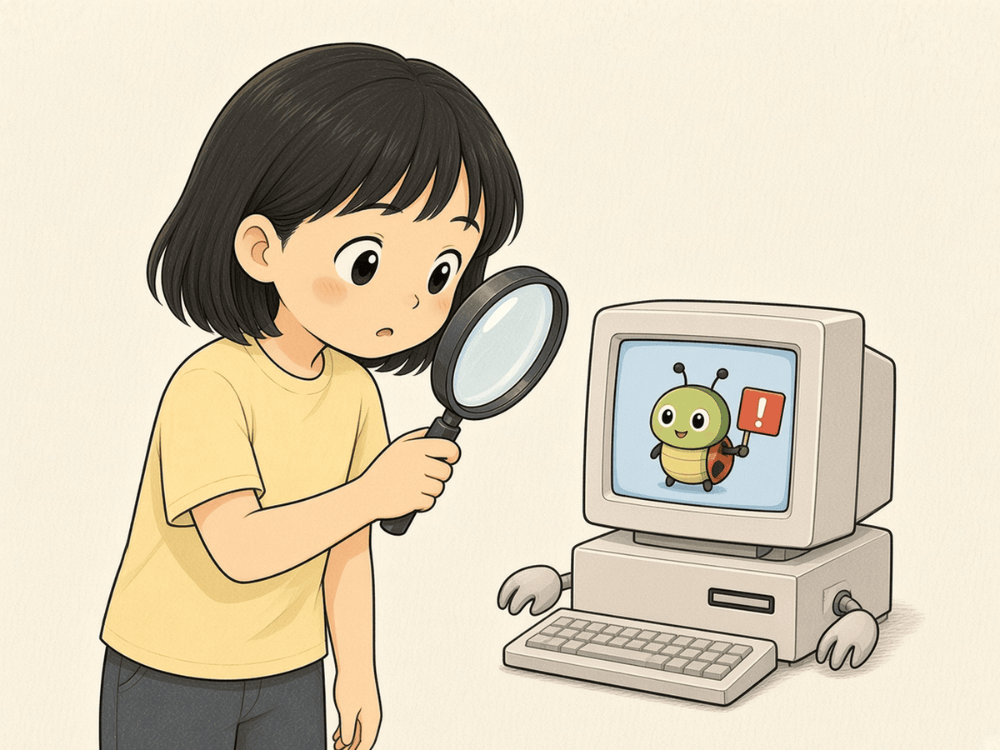
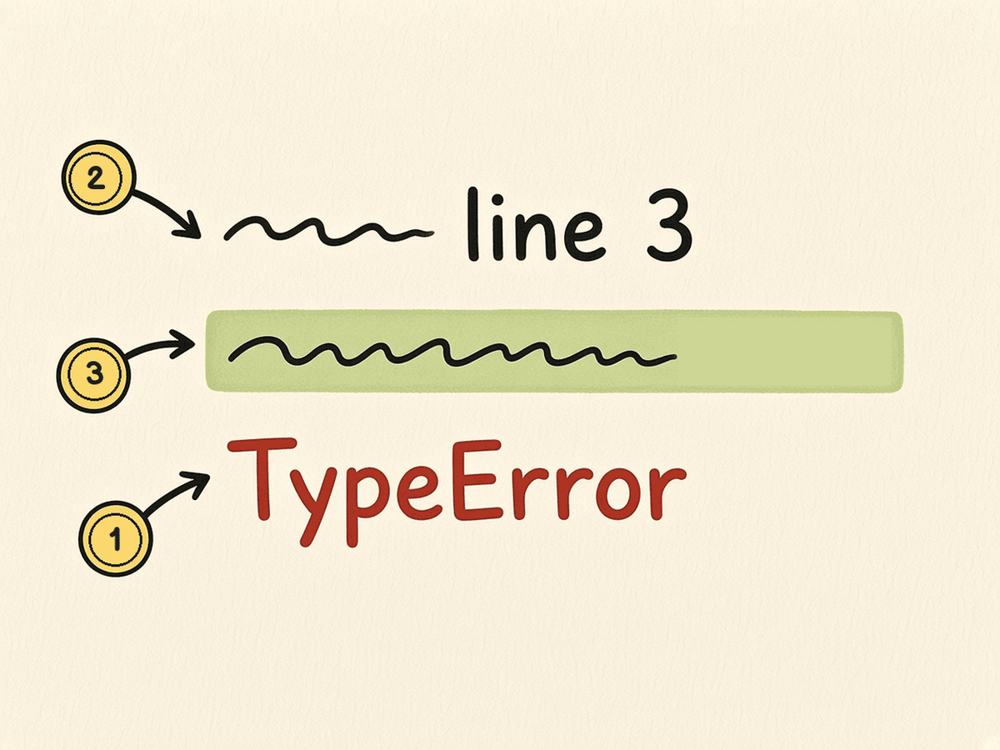
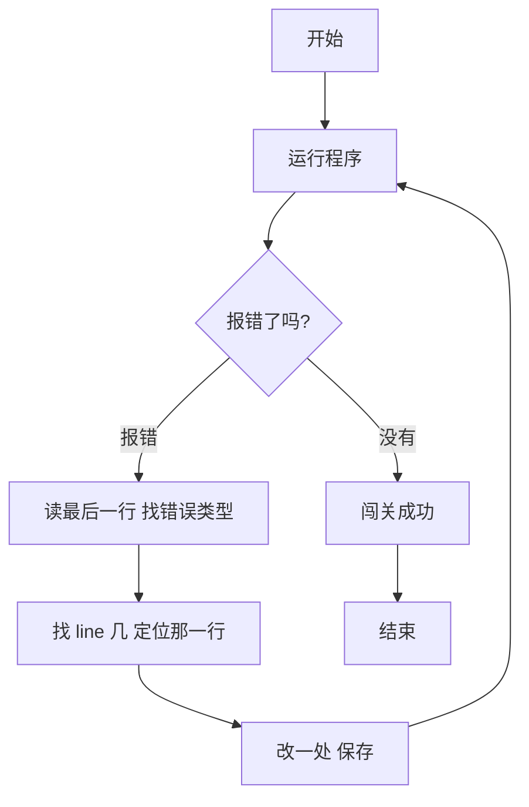
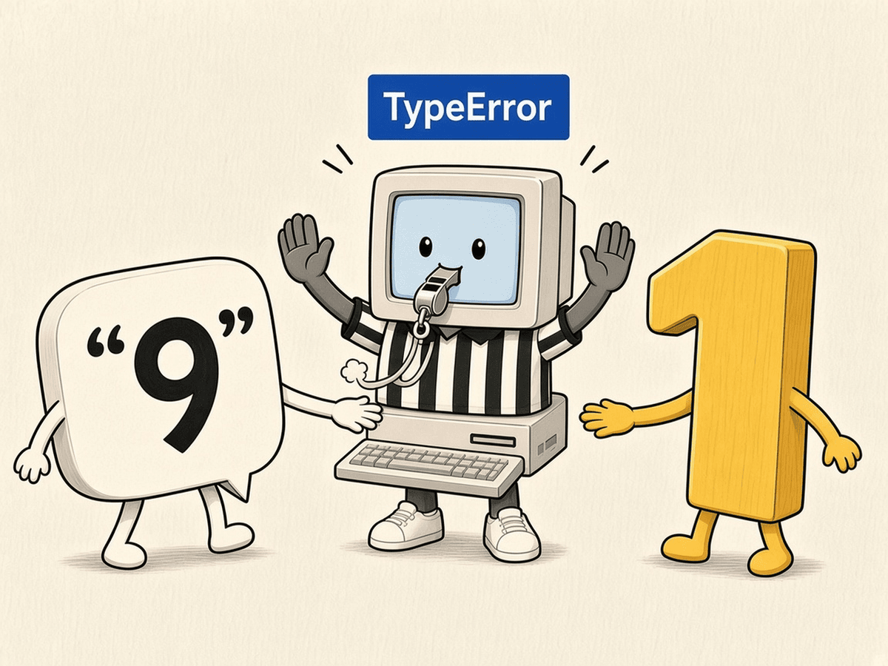

# 第 12 章 · 报错与调试

程序报错不是你笨，是电脑在给你写纸条：哪里看不懂。学会读这张纸条，你就能自己修 bug。这一章玩「修 bug 闯关」：先跑坏程序，读报错，再修好。

## 漫画开场



小虫子：「嘿嘿，第 3 行有我！」
主角：「别慌，先看报错的最后一行。」

## 概念

- **bug**：程序里的错误；**调试**：找到并修好它。
- 读报错三步：
  1. 看**最后一行**：错误类型 + 说明，例如 `TypeError`。
  2. 往上找 `line 几`：错在第几行。
  3. 回到那一行，想想每个变量此刻是什么类型、什么值。
- 常见错误：
  - `SyntaxError`：语法写错，比如漏了冒号或括号。
  - `NameError`：用了没定义的名字（常是拼错）。
  - `TypeError`：类型不对，比如文字加数字。
  - `ValueError`：值不对，比如 `int("三")`。
  - `IndentationError`：缩进乱了。
- 调试小技巧：在可疑处加 `print(变量)` 看看它到底是什么。



## 流程图或伪代码



## 照着打

先照着打这个**有 bug** 的程序，运行，输入 `9`：

```python
# buggy.py：有一个错误
age = input("你几岁？ ")
next_year = age + 1
print("明年你就 " + str(next_year) + " 岁啦！")
```

你会看到：

```
TypeError: can only concatenate str (not "int") to str
```

意思是：文字（str）只能和文字拼接，不能和数字（int）相加。错在第 3 行，因为 `input` 拿到的 `age` 是文字。修法：在第 2 行把它变成数字。



```python
# fixed.py：修好的版本
age = int(input("你几岁？ "))
next_year = age + 1
print("明年你就 " + str(next_year) + " 岁啦！")
```


## 小项目：修 bug 闯关

目标：运行 `buggy.py` 读懂报错，对照 `fixed.py` 说出改了哪里、为什么。
完整代码：见 `code/ch12/buggy.py` 与 `code/ch12/fixed.py`
实验清单：见 `experiments/ch12.md`（含报错原文与修法）


## 高年级挑战题
<!-- high -->
1. 运行 `fixed.py` 时输入「九」，会出现什么新错误？它和 `TypeError` 有什么不同？
2. 故意删掉 `print` 后面的一个右括号，读 `SyntaxError` 的提示，它指的行号准吗？
3. 回到第 6、7 章的程序，各制造一个 `IndentationError`，再修好，记下报错原文。
