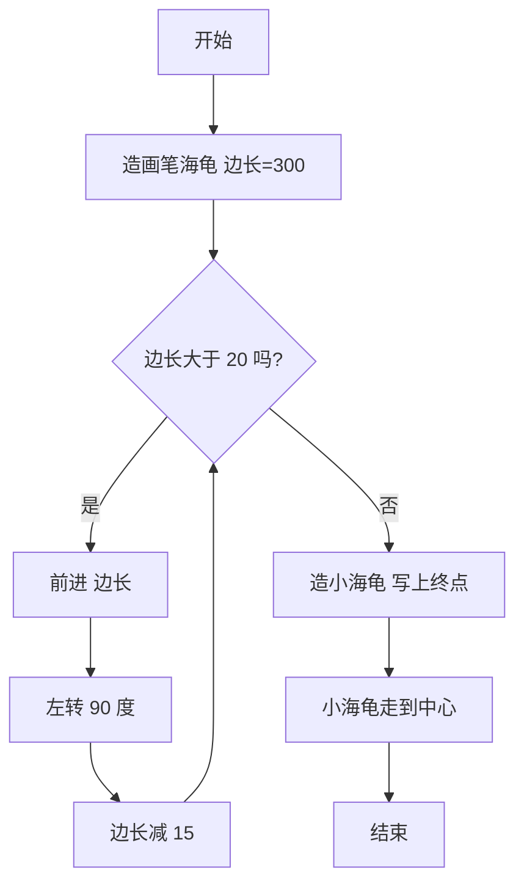

# 第 13 章 · 简单图形 turtle

前面的程序都在打印文字，这一章让电脑画画。Python 自带一只小海龟 turtle，你让它走、让它转，它就留下线条。我们用循环画一座螺旋迷宫，再让小海龟走到中心。

## 漫画开场
（插图位：一只拿着画笔的小海龟站在白纸中央，主角小朋友举着遥控器；见 `art-briefs/ch13.md` 画面 1–2）

主角：「前进 300 步，左转！」
小海龟：「收到！再说一遍我就画出一座迷宫。」

## 概念

- `import turtle`：把 Python 自带的画图工具拿出来用。
- `turtle.Turtle()`：造一只海龟，存进变量（如 `pen`）。
- `forward(步数)` 前进；`left(角度)` / `right(角度)` 转身。
- `penup()` 抬笔（走路不画线），`pendown()` 落笔。
- `goto(x, y)` 直接走到坐标点，画布中心是 `(0, 0)`。
- `speed(0)` 最快；`turtle.done()` 画完别关窗口。
- 本章需要**有窗口的电脑**（Thonny 里直接运行即可）。

<!-- high -->
螺旋迷宫的秘密：每画一条边就左转 90 度，边长每次减 15。把「边长变短」换成「转的角度变小」，图案会完全不同——这就是用变量控制图形。
<!-- /high -->

## 流程图或伪代码



## 照着打

照着打，运行后会弹出一个画布窗口：

```python
# turtle 迷宫
import turtle

pen = turtle.Turtle()
pen.speed(0)
pen.pensize(3)

wall_length = 300
while wall_length > 20:
    pen.forward(wall_length)
    pen.left(90)
    wall_length = wall_length - 15

walker = turtle.Turtle()
walker.shape("turtle")
walker.color("green")
walker.penup()
walker.goto(150, 150)
walker.write("终点", align="center", font=("Arial", 14, "normal"))
walker.goto(0, 0)

turtle.done()
```

## 小项目：迷宫

目标：用循环画出螺旋迷宫，让绿色小海龟走到中心。
完整代码：见 `code/ch13/maze.py`
实验清单：见 `experiments/ch13.md`（需本机窗口运行）

## 高年级挑战题
<!-- high -->
1. 把 `left(90)` 改成 `left(91)`，再改成 `left(120)`，画出来的图有什么变化？
2. 嵌套循环：用两层循环画 4 个排成一排的正方形（外层管第几个，内层画四条边）。
3. 边界情况：如果把 `wall_length - 15` 写成 `wall_length + 15`，循环会停吗？先想再试，准备好关窗口。
