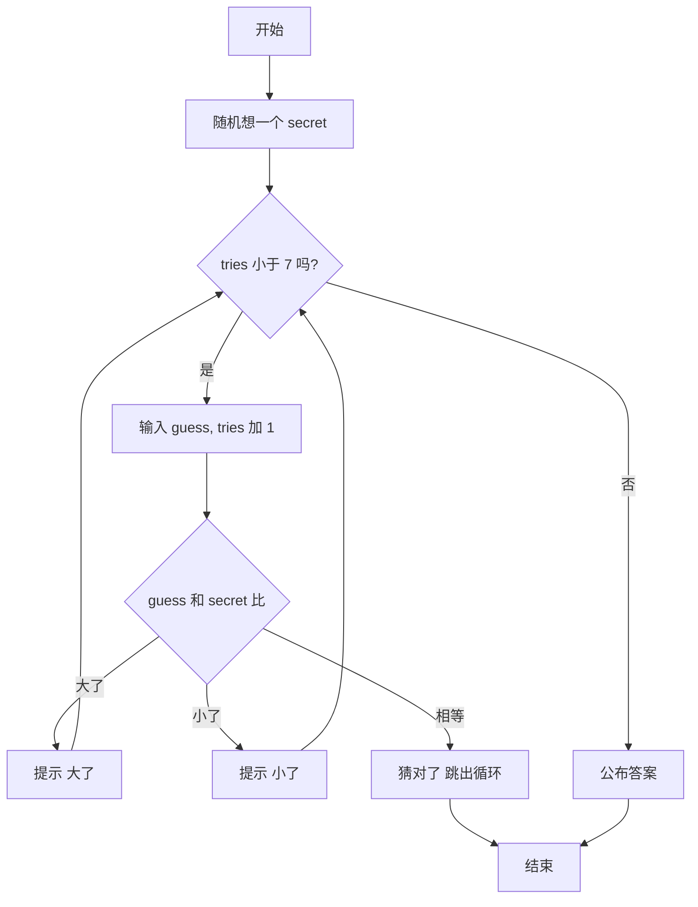

# 第 14 章 · 小游戏综合

把前面学的变量、判断、循环拼起来，就能做一个真正能玩的游戏。电脑偷偷想一个 1～100 的数，你最多猜 7 次，它会告诉你大了还是小了。这一章还会认识「随机数」。

## 漫画开场
（插图位：电脑把一张写着问号的卡片藏到背后，主角小朋友托腮思考；见 `art-briefs/ch14.md` 画面 1–2）

电脑：「我想好了，你猜！只有 7 次机会哦。」
主角：「先猜 50，一下砍掉一半！」

## 概念

- `import random`：拿出随机工具；`random.randint(1, 100)` 随机给一个 1～100 的整数（两头都包含）。
- `while 条件:` 条件为真就一直重复，适合「不知道要猜几次」的情况。
- **次数上限**：用 `tries` 计数，`tries < max_tries` 才继续，防止停不下来（还记得第 2 章拉链的上限吗？）。
- `break`：猜对了就立刻跳出循环。
- 用 `won`（`True` / `False`）记住「赢了没有」，循环结束后再决定说什么。

<!-- high -->
**固定随机种子**：`random.seed(42)` 写在 `randint` 之前，每次运行都会得到同一个「随机」数，方便测试和给同学出同一道题。正式玩时去掉这一行。
<!-- /high -->

## 流程图或伪代码



## 照着打

照着打，然后试试每次都猜「剩下范围的正中间」：

```python
# 猜数字加强版
import random

secret = random.randint(1, 100)
max_tries = 7
tries = 0
won = False

print("我想好了一个 1～100 的数字，你有 " + str(max_tries) + " 次机会！")
while tries < max_tries:
    guess = int(input("第 " + str(tries + 1) + " 次，你猜是几？ "))
    tries = tries + 1
    if guess > secret:
        print("大了！")
    elif guess < secret:
        print("小了！")
    else:
        print("猜对了！你用了 " + str(tries) + " 次。")
        won = True
        break

if not won:
    print("机会用完啦，答案是 " + str(secret) + "。")
```

## 小项目：猜数字加强版

目标：有次数上限（7 次）和高低提示的猜数字游戏。
完整代码：见 `code/ch14/guess_number.py`
实验清单：见 `experiments/ch14.md`（含固定种子复现方法）

## 高年级挑战题
<!-- high -->
1. 为什么 1～100 最多 7 次一定能猜中？提示：每次砍一半，2 的几次方超过 100？
2. 边界情况：输入 `0` 或 `150` 时提示「请猜 1～100 之间」，而且这次不算次数。
3. 加难度选择：先问「简单 / 困难」，简单是 1～50、10 次，困难是 1～200、8 次（用第 10 章的字典存难度设置）。
