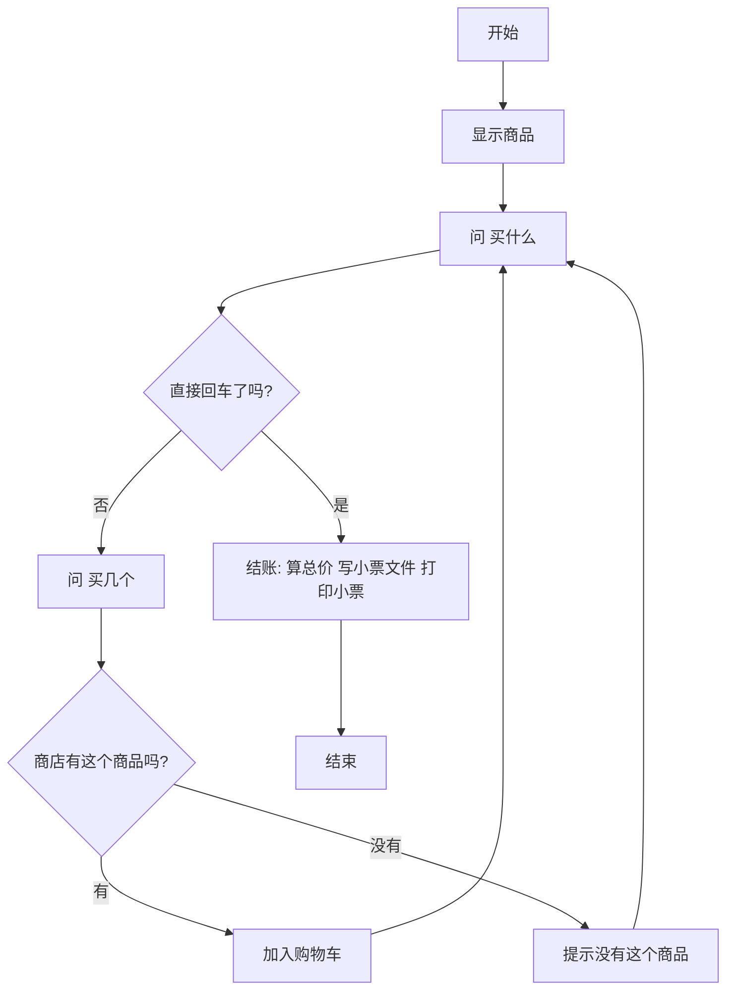

# 第 16 章 · 综合大项目与继续学

最后一章，你要用前面所有本领开一家自己的小商店：有商品表、购物车、结账小票，还会把小票存成文件。做完之后，我们聊聊接下来怎么继续学，以及家长可以怎么陪你。

## 漫画开场
（插图位：主角小朋友站在自己开的小文具店柜台后，墙上挂着前 15 章的技能徽章；见 `art-briefs/ch16.md` 画面 1–2）

同学：「老板，我要四支铅笔！」
主角：「函数、字典、列表、循环、判断、文件——全员上岗，马上给你出小票！」

## 概念

本章没有新语法，是一次「大集合」：

| 用到的本领 | 在商店里干什么 | 来自 |
| --- | --- | --- |
| 函数 | `show_goods` / `add_to_cart` / `checkout` 三个岗位 | 第 9 章 |
| 字典 | 商品名 → 价格 | 第 10 章 |
| 列表 | 购物车 `cart` | 第 8 章 |
| 循环 | 一直问「买什么」，直到回车结账 | 第 7、14 章 |
| 判断 | 没有这个商品就提醒 | 第 6 章 |
| 文件 | 小票写进 `receipt.txt` | 第 11 章 |

做大项目的方法：**先画流程图，再一个函数一个函数写，每写完一个就运行一次**（第 2、12 章的老办法）。

## 流程图或伪代码



## 照着打

这是全书最长的程序，分三段照着打：先打商品和三个函数，最后打下面的循环。

```python
# 综合大项目：简易商店
from pathlib import Path

goods = {"铅笔": 1.5, "橡皮": 2, "笔记本": 5, "贴纸": 3}
cart = []
receipt_path = Path(__file__).parent / "receipt.txt"


def show_goods():
    print("=== 今日商品 ===")
    for item in goods:
        print(item + "：" + str(goods[item]) + " 元")


def add_to_cart(item, count):
    if item in goods:
        cart.append([item, count])
        print("已加入：" + item + " × " + str(count))
    else:
        print("没有这个商品：" + item)


def checkout():
    total = 0
    lines = []
    for item, count in cart:
        cost = goods[item] * count
        total = total + cost
        lines.append(item + " × " + str(count) + " = " + str(cost) + " 元")
    lines.append("合计：" + str(total) + " 元")
    with open(receipt_path, "w", encoding="utf-8") as receipt_file:
        for line in lines:
            receipt_file.write(line + "\n")
    print("=== 小票 ===")
    for line in lines:
        print(line)


show_goods()
while True:
    item = input("买什么？（直接回车结账） ")
    if item == "":
        break
    count = int(input("买几个？ "))
    add_to_cart(item, count)
checkout()
```

## 小项目：简易商店

目标：选商品、加购物车、结账打印小票，并把小票存成 `receipt.txt`。
完整代码：见 `code/ch16/mini_shop.py`
实验清单：见 `experiments/ch16.md`

### 怎么继续学

- **回头做挑战题**：每章 `<!-- high -->` 的题目是最好的下一步。
- **改自己的版本**：把商店改成游戏道具店，把猜数字改成猜成语，比学新东西更练手。
- **再往上走**：熟练以后，可以学更多标准库（如 `datetime`），也可以参考青少年编程等级考试的大纲查漏补缺（只参考，不用死追等级）。

### 和 Type Ninja 一起练打字

编程有一半是打字：括号 `()`、冒号 `:`、引号 `""`、等号 `=` 和 `==`。如果你常常找不到这些键，可以用 **Type Ninja** 的编程预备课练一练——从手指放哪开始，到符号练习，再到照打一行 Python。每天练 10 分钟，回来再「照着打」，你会快很多。

### 家长陪练小贴士

1. **陪而不代**：孩子打字慢没关系，请别替他敲；可以帮忙点「运行」、念报错的最后一行。
2. **先夸再问**：程序跑起来先夸一句，再问「你能让它多做一件事吗？」。
3. **报错是好事**：和孩子一起按第 12 章三步读报错，把「修好一个 bug」当成闯关成功。
4. **短而常**：每次 20～30 分钟，一周 3～4 次，比周末突击 3 小时更有效。
5. **留作品**：把每章的小项目存在一个文件夹里，期末一起翻看，孩子会很有成就感。

## 高年级挑战题
<!-- high -->
1. 加库存：每种商品只有 5 个，卖完要提示「卖光了」（字典里再放一个字典，或者另建一个库存字典）。
2. 边界情况：「买几个」输入了 `0` 或负数怎么办？加判断拒绝它。
3. 满减：总价满 10 元减 1 元，在 `checkout` 里加上，并写进小票。
4. 二选一大项目的另一条路：用字典描述房间（`{"大厅": {"北": "厨房"}}`），做一个文字冒险游戏。
