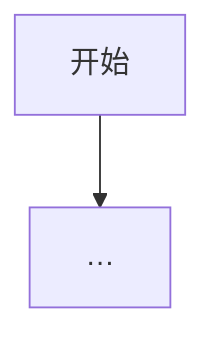

# 小学生学编程（Python · 漫画）实施计划

> **For agentic workers:** REQUIRED SUB-SKILL: Use superpowers:subagent-driven-development (recommended) or superpowers:executing-plans to implement this plan task-by-task. Steps use checkbox (`- [ ]`) syntax for tracking.

**Goal:** 按已定设计产出可写作的书稿工程：目录、章模板、逐章文稿与可跑通的 Python 案例，插图位先占位，插图后做。

**Architecture:** 双线螺旋。每章固定六段（漫画开场 → 概念 → 流程图或伪代码 → 可照打代码 → 小项目 → 高年级挑战题）。低年级可读前五段；高年级加挑战题。考纲只参考不硬对齐。md 为准，Notion「Bot 舰队资料库」同步副本。

**Tech Stack:** Markdown 书稿；Python 3.10+（标准库 + turtle）；示例统一用 Thonny 友好写法；流程图用 mermaid 占位，正式出版再换成漫画图。

## Global Constraints

- 读者：小学全段；低年级多图少字，高年级加深
- 语言：中文正文；代码标识符可用英文，注释与讲解用中文
- 每章必须有一个可独立跑通的小项目；命令先实测再写进稿
- 不进主册：电子学会五六级内容（pandas / SQLite / 类与二叉树）；需要时只放附录意向，本计划不做
- 插图：本计划只写「插图位说明」，不出成品图
- 用途与出版形态后定；本计划交付物是书稿工程与分章成稿，不代发、不接洽出版社
- 设计源：`/workspace/plans/kids-python-book/2026-11-02-设计要点.md` 与 Notion https://app.notion.com/p/40c44b78e39a81caa82ec6627e1682b0
- 考纲速查：`/workspace/research/kids-python-book/2026-11-02-小学生计算机等级大纲速查.md`

---

## File Structure

```
/workspace/books/kids-python/
  README.md                 # 工程说明与读法
  STYLE.md                  # 声口、禁区、双线标注约定
  TOC.md                    # 定稿目录
  TEMPLATE-chapter.md       # 章模板
  experiments/              # 每章实验清单与实测记录
  chapters/
    01-计算机与Python.md
    02-程序概念与流程图.md
    ...
    16-综合与继续学.md
  code/
    ch03/hello.py
    ...
  art-briefs/               # 每章插图位清单（后做）
```

---

### Task 1: 建立书稿工程骨架

**Files:**
- Create: `/workspace/books/kids-python/README.md`
- Create: `/workspace/books/kids-python/STYLE.md`
- Create: `/workspace/books/kids-python/TOC.md`
- Create: `/workspace/books/kids-python/TEMPLATE-chapter.md`
- Create: `/workspace/books/kids-python/experiments/README.md`
- Create: `/workspace/books/kids-python/art-briefs/README.md`

**Interfaces:**
- Consumes: 设计要点中的 16 章目录与每章规格
- Produces: 固定目录路径与章模板字段，供后续 Task 逐章填写

- [ ] **Step 1: 建目录**

```bash
mkdir -p /workspace/books/kids-python/{chapters,code,experiments,art-briefs}
```

- [ ] **Step 2: 写 README.md**

内容必须包含：书名工作名「小学生学编程（Python · 漫画）」、双线读法、工程路径说明、与 Type Ninja 的衔接一句话、插图后做声明。

- [ ] **Step 3: 写 STYLE.md**

约定至少包含：
1. 称呼读者为「你」；不恐吓、不说教
2. 每章标题下第一段不超过 3 句
3. 代码块前必须有「照着打」提示；变量名用完整英文词，不用单字母（循环计数除外）
4. 用 `<!-- low -->` / `<!-- high -->` 标注低年级可跳过的高年级段
5. 禁止：同行 diss、超纲库、未实测命令

- [ ] **Step 4: 写 TOC.md**

逐条复制设计定稿 16 章标题与项目名（含第 2 章流程图）。

- [ ] **Step 5: 写 TEMPLATE-chapter.md**

模板字段固定为：

```markdown
# 第 N 章 · 标题

## 漫画开场
（插图位：…）

## 概念
…

## 流程图或伪代码


## 照着打
```python
# …
```

## 小项目：名称
目标：…
完整代码：见 `code/chNN/…`
实验清单：见 `experiments/chNN.md`

## 高年级挑战题
<!-- high -->
…
```

- [ ] **Step 6: 写 experiments/README.md 与 art-briefs/README.md**

说明：每章一个 `chNN.md` 实验清单（命令、期望输出、实测日期）；每章一个插图位 brief，本阶段可空文件只列占位规则。

- [ ] **Step 7: 自检**

```bash
test -f /workspace/books/kids-python/TEMPLATE-chapter.md && test -f /workspace/books/kids-python/TOC.md && ls /workspace/books/kids-python
```

Expected: 列出 README STYLE TOC TEMPLATE 与四个子目录。

---

### Task 2: 第 1–3 章（开篇包）成稿骨架 + 可跑代码

**Files:**
- Create: `/workspace/books/kids-python/chapters/01-计算机与Python.md`
- Create: `/workspace/books/kids-python/chapters/02-程序概念与流程图.md`
- Create: `/workspace/books/kids-python/chapters/03-装环境与第一行代码.md`
- Create: `/workspace/books/kids-python/code/ch03/hello_dressup.py`
- Create: `/workspace/books/kids-python/experiments/ch02.md`
- Create: `/workspace/books/kids-python/experiments/ch03.md`
- Create: `/workspace/books/kids-python/art-briefs/ch01.md` … `ch03.md`

**Interfaces:**
- Consumes: TEMPLATE-chapter.md、TOC 第 1–3 章
- Produces: 开篇三章可审阅 md；ch03 脚本 `print` 可跑

- [ ] **Step 1: 写第 2 章流程图示例（先于环境章，强调「先想再敲」）**

章内 mermaid 必须包含顺序、判断、循环各至少一处；小项目把「起床上学」画成流程图再写成伪代码（本步不要求 Python 文件）。

- [ ] **Step 2: 写 ch03 脚本**

```python
# /workspace/books/kids-python/code/ch03/hello_dressup.py
name = input("你叫什么名字？ ")
print("你好，" + name + "！")
print("今天我们用 Python 跟电脑说话。")
```

- [ ] **Step 3: 实测**

```bash
printf '小明\n' | python3 /workspace/books/kids-python/code/ch03/hello_dressup.py
```

Expected: 两行问候，含「小明」。

- [ ] **Step 4: 按模板写满三章 md，并在 experiments/ch03.md 记录上述命令与输出**

- [ ] **Step 5: 插图位 brief 各写 3–6 条画面说明（角色未定，用「主角小朋友」占位）**

---

### Task 3: 第 4–8 章（基础语法包）

**Files:**
- Create: `chapters/04-变量与输入输出.md` … `08-列表.md`
- Create: `code/ch04/` … `code/ch08/` 各一可跑主脚本
- Create: `experiments/ch04.md` … `ch08.md`
- Create: `art-briefs/ch04.md` … `ch08.md`

**Interfaces:**
- Consumes: 章模板；项目名固定为设计稿：自我介绍生成器、小卖部计算器、猜拳裁判、倒计时火箭、班级点名册
- Produces: 五章成稿 + 五份实测记录

项目脚本最低验收：

| 章 | 文件 | 验收 |
| --- | --- | --- |
| 4 | `code/ch04/intro_generator.py` | 询问姓名爱好后打印一段自我介绍 |
| 5 | `code/ch05/shop_calculator.py` | 输入单价与数量，打印应付金额 |
| 6 | `code/ch06/rps_judge.py` | 输入两拳（石头/剪刀/布），打印胜负 |
| 7 | `code/ch07/rocket_countdown.py` | 从 N 倒数到 1 再打印发射 |
| 8 | `code/ch08/roll_call.py` | 列表存名字，循环打印「到！」 |

- [ ] **Step 1: 逐章先写脚本再实测，把命令写入 experiments**
- [ ] **Step 2: 按模板写 md，概念段必须出现对应流程图或伪代码**
- [ ] **Step 3: 每章至少 1 道 `<!-- high -->` 挑战题（嵌套或边界情况）**

---

### Task 4: 第 9–12 章（积木包）

**Files:**
- Create: `chapters/09-函数.md` … `12-报错与调试.md`
- Create: `code/ch09/` … `code/ch12/`
- Create: 对应 experiments 与 art-briefs

项目固定：心情天气播报、宠物档案卡、日记本、修 bug 闯关。

- [ ] **Step 1: ch09 至少一个自定义函数；禁止递归（主册不做四级拔高）**
- [ ] **Step 2: ch10 字典增删改查各出现一次**
- [ ] **Step 3: ch11 读写同一个 `diary.txt`；实测追加两行**
- [ ] **Step 4: ch12 提供故意出错的 `buggy.py` 与修好的 `fixed.py`，实验清单写清报错原文与修法**

---

### Task 5: 第 13–16 章（作品与收束）

**Files:**
- Create: `chapters/13-简单图形turtle.md` … `16-综合与继续学.md`
- Create: `code/ch13/` … `code/ch15/`（16 章可复用前章模块）
- Create: 对应 experiments 与 art-briefs

- [ ] **Step 1: ch13 turtle 迷宫或规则图形；无显示器环境用「语法检查」`python3 -m py_compile` 验收，并在 experiments 注明需本机窗口运行**
- [ ] **Step 2: ch14 猜数字加强版：有次数上限与高低提示**
- [ ] **Step 3: ch15 用标准库做简易统计（如列表算平均）并打印文本柱状；不引入 pandas**
- [ ] **Step 4: ch16 综合大项目二选一（文字冒险或简易商店）+ Type Ninja 衔接段 + 家长陪练小贴士；不写出版发行内容**

---

### Task 6: 全书联校与 Notion 同步

**Files:**
- Modify: `/workspace/books/kids-python/README.md`（补「完成度」表）
- Create: `/workspace/plans/kids-python-book/2026-11-02-实施计划.md`（本计划副本链接说明）
- Notion: 在设计页下或同级建「实施计划」页，贴计划路径与完成度

- [ ] **Step 1: 跑一遍所有非 turtle 脚本的批测**

```bash
find /workspace/books/kids-python/code -name '*.py' ! -path '*ch13*' -print
# 对每个非交互脚本执行 python3；交互脚本用 printf 喂入，命令写入 experiments/batch-smoke.md
```

- [ ] **Step 2: 检查 16 章均含六段标题；缺段则补**
- [ ] **Step 3: 同步 Notion（md 为准，给用户交付 Notion 地址）**
- [ ] **Step 4: 短报交幕僚长：结论、完成章数、未测项（如 turtle）、要用户点头的事（是否开插图、是否开第 1 章精修）**

---

## Spec coverage（自检）

| 设计要求 | 对应 Task |
| --- | --- |
| 双线螺旋 / 每章规格 | Task 1 模板 + 各章 Task |
| 16 章含流程图章 | TOC + Task 2 第 2 章 |
| 考纲只参考 | Global Constraints；不硬塞五六级 |
| 插图后说 | art-briefs 占位，Task 不画图 |
| 系统语法+小项目 | Task 3–5 |
| Type Ninja 衔接 | Task 5 ch16 |
| md 为准 + Notion 副本 | Task 6 |

## Placeholder scan

无 TBD/TODO；脚本与路径均为实值。

---

## Execution handoff

Plan complete and saved to `docs/superpowers/plans/2026-11-02-kids-python-comic-book.md`.

执行方式请用户选：

1. **分章派工（推荐）**：每完成一个 Task 验收再开下一 Task  
2. **本对话连续执行**：按 Task 顺序在本会话推进，关键节点暂停给你看  

（书稿项目不强制 git commit；若你要求纳入某仓库再另开 source-control 流程。）
